# ELEC 3 - Node.js Programming


## Student Information

- **Name:** Daniel Eidderf P. Manaois
- **Section:** IV-BSIT-A
- **Course:** ELEC 3 - Node.js Programming

## Overview

This repository contains my self-paced learning activities
for ELEC 3 - Node.js Programming.

The activities demonstrate package management, modular
programming, file handling, HTTP servers, REST APIs,
and middleware.

## Set 1 - Node.js Fundamentals

| Activity | Description | Folder |
|---|---|---|
| N1 - Project Setup and Package Management | Initialize a Node.js project, install npm packages, and configure npm scripts. | [View Activity](set1/n1-setup/) |
| N2 - Modular Calculator | Perform mathematical operations using custom modules and command-line arguments. | [View Activity](set1/n2-calculator/) |
| N3 - File Manager with fs and path | Create, read, update, delete, and list text files using built-in Node.js modules. | [View Activity](set1/n3-file-manager/) |

## Set 2 - Node.js Server and API Development

| Activity | Description | Folder |
|---|---|---|
| N4 - Basic HTTP Server | Create an HTTP server with multiple routes. | Pending |
| N5 - REST-style API | Implement CRUD operations through HTTP methods. | Pending |
| N6 - Middleware and API Testing | Implement middleware and test API endpoints. | Pending |

## Prerequisites

- Node.js
- npm
- Visual Studio Code
- Git

## How to Run

Start each activity from the repository root.

### N1 - Project Setup and Package Management

```bash
cd set1/n1-setup
npm install
npm start
cd ../..
```

### N2 - Modular Calculator

```bash
node set1/n2-calculator/index.js add 20 4
node set1/n2-calculator/index.js subtract 30 6
node set1/n2-calculator/index.js multiply 4 6
node set1/n2-calculator/index.js divide 120 5
node set1/n2-calculator/index.js average 40 8
```

Error handling tests:

```bash
node set1/n2-calculator/index.js divide 24 0
node set1/n2-calculator/index.js power 20 4
```

### N3 - File Manager with fs and path

```bash
cd set1/n3-file-manager

node index.js create example.txt "Hello Node.js"
node index.js read example.txt
node index.js update example.txt "Additional content"
node index.js delete example.txt
node index.js list

cd ../..
```

Use an unused filename when creating a new file.

## Program Screenshots

### N1 - Project Setup and Package Management

#### Node.js and npm Version Check

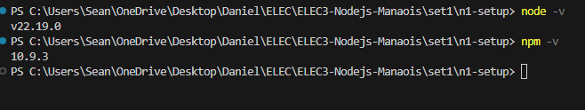

#### npm Project Initialization

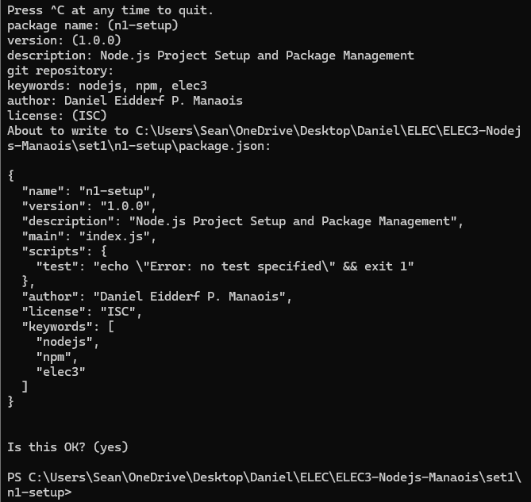

#### Package Configuration

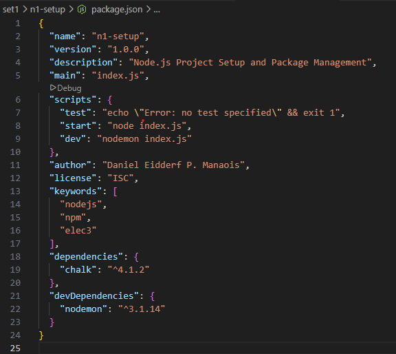

#### Program Execution

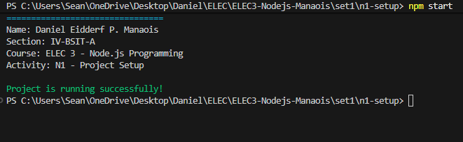

#### Written Answers

[View N1 Written Answers](set1/n1-setup/N1_answers.docx)

---

### N2 - Modular Calculator

#### Addition

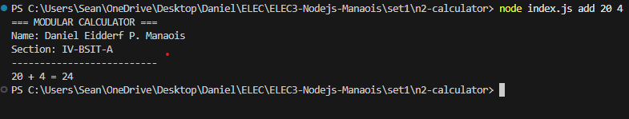

#### Subtraction

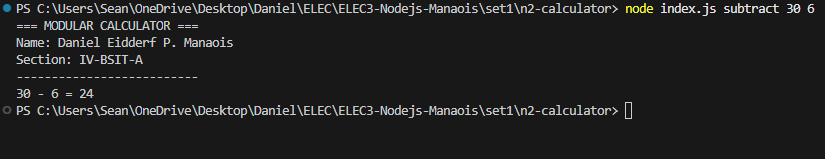

#### Multiplication

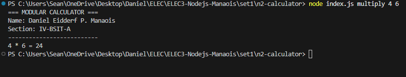

#### Division

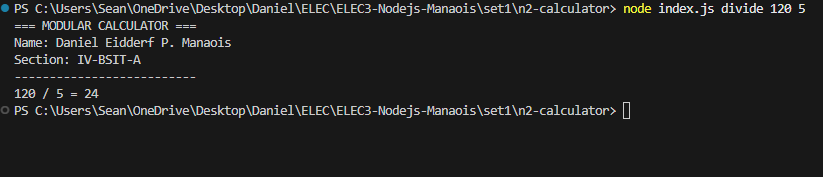

#### Average

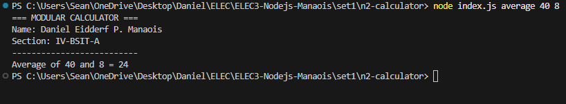

#### Division by Zero

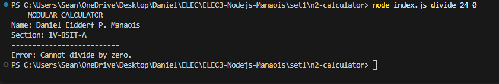

#### Unknown Operation

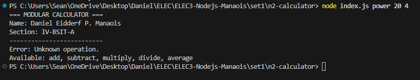

---

### N3 - File Manager with fs and path

#### Create Files

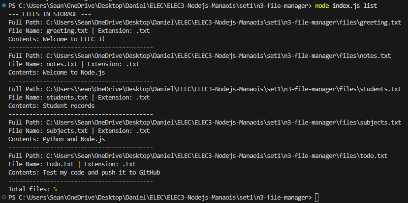

#### Read File

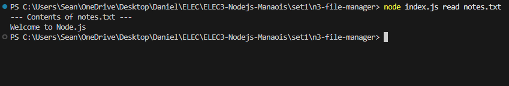

#### Update File

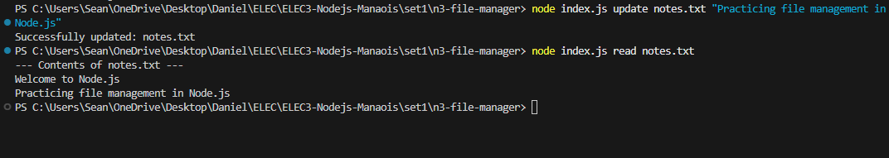

#### Delete File

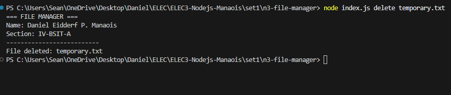

#### List Files

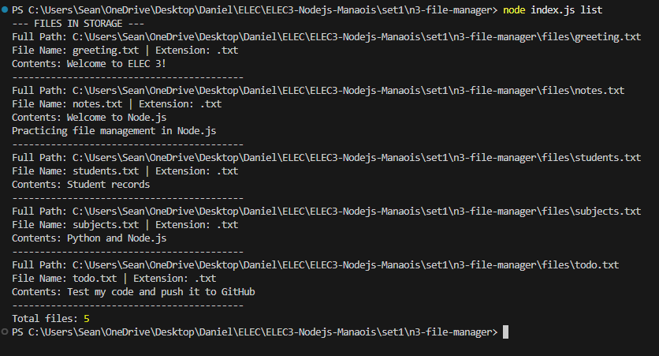

#### Missing File - Read Error

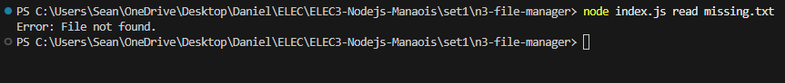

#### Missing File - Delete Error

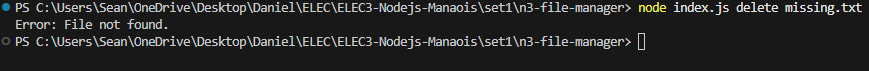

## Technologies Used

- JavaScript
- Node.js
- npm
- Visual Studio Code
- Git and GitHub

## Learning References

- [Node.js Crash Course - Traversy Media](https://www.youtube.com/watch?v=32M1al-Y6Ag)
- [Node.js Documentation](https://nodejs.org/docs/latest/api/)
- [npm Documentation](https://docs.npmjs.com/)

---

ELEC 3 - Node.js Programming | Academic Year 2026-2027
